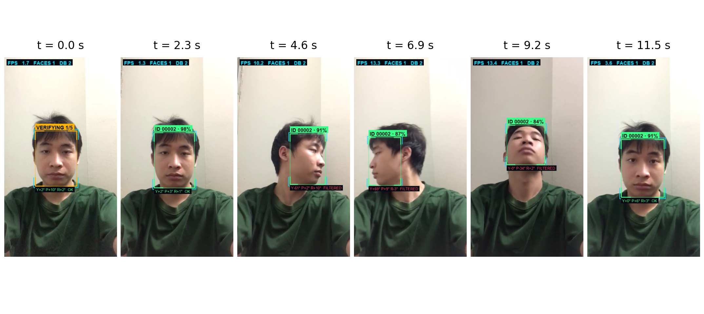
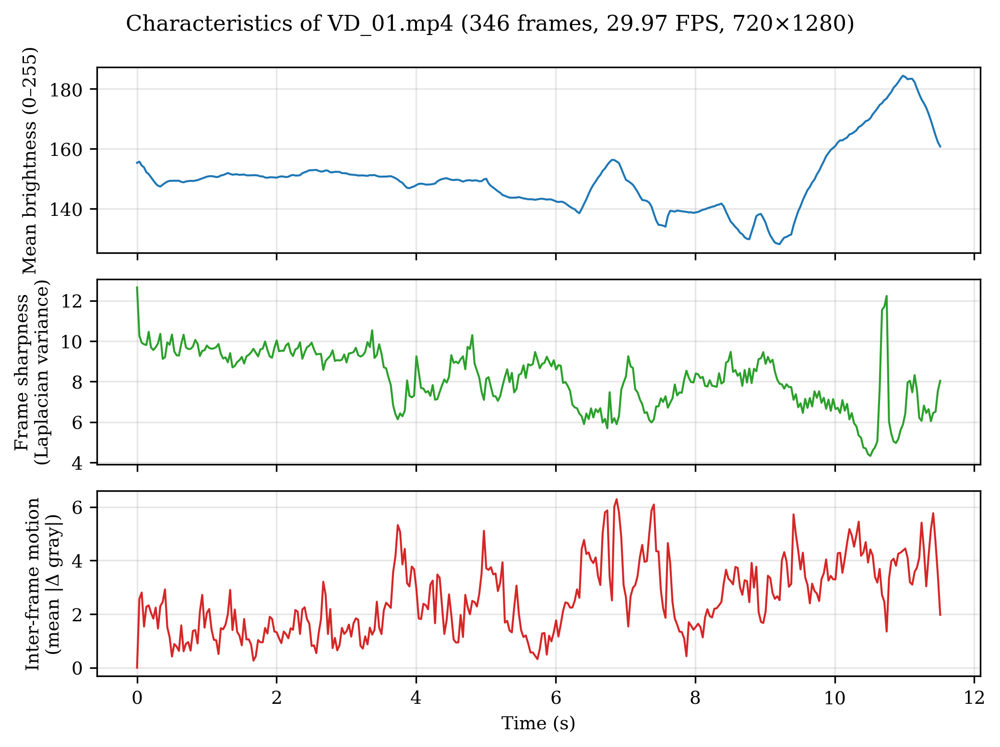
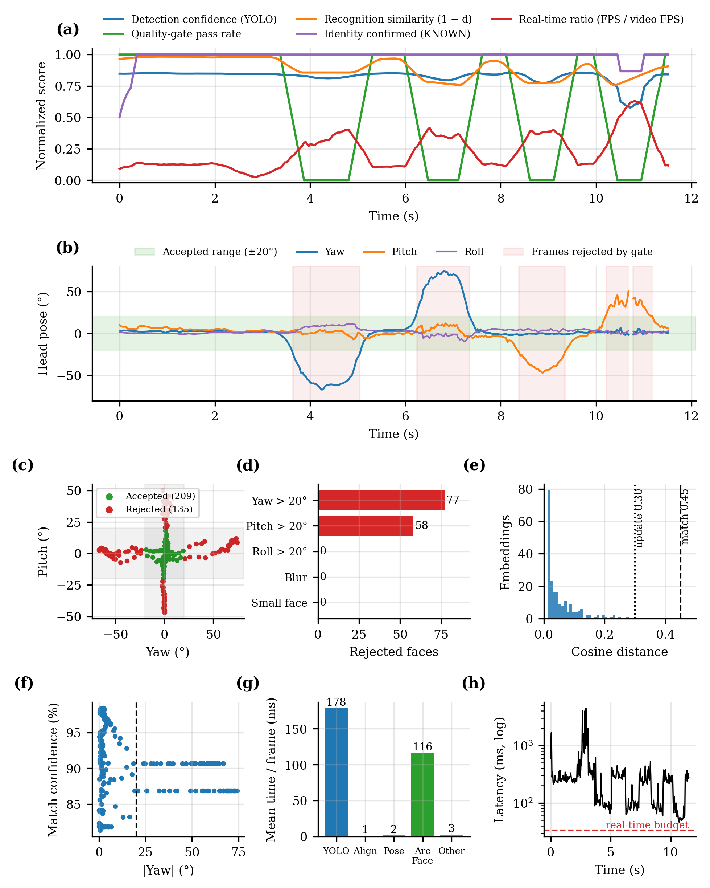
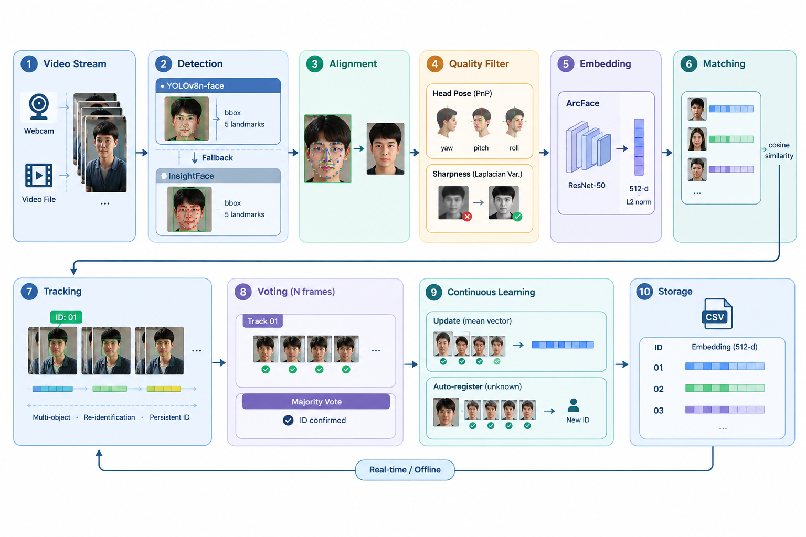
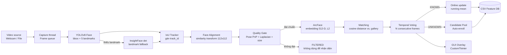
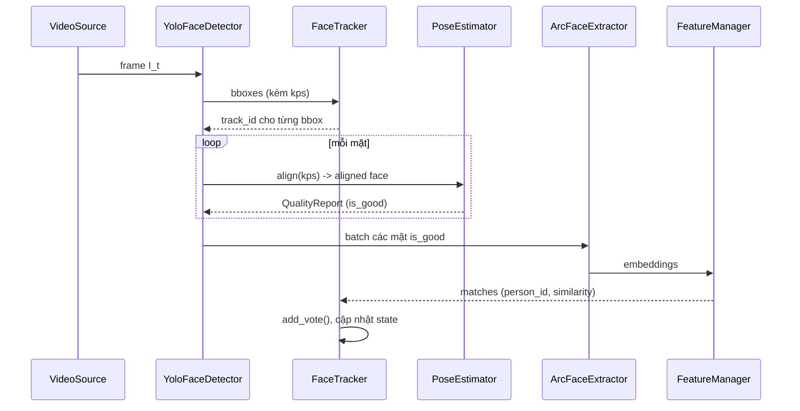
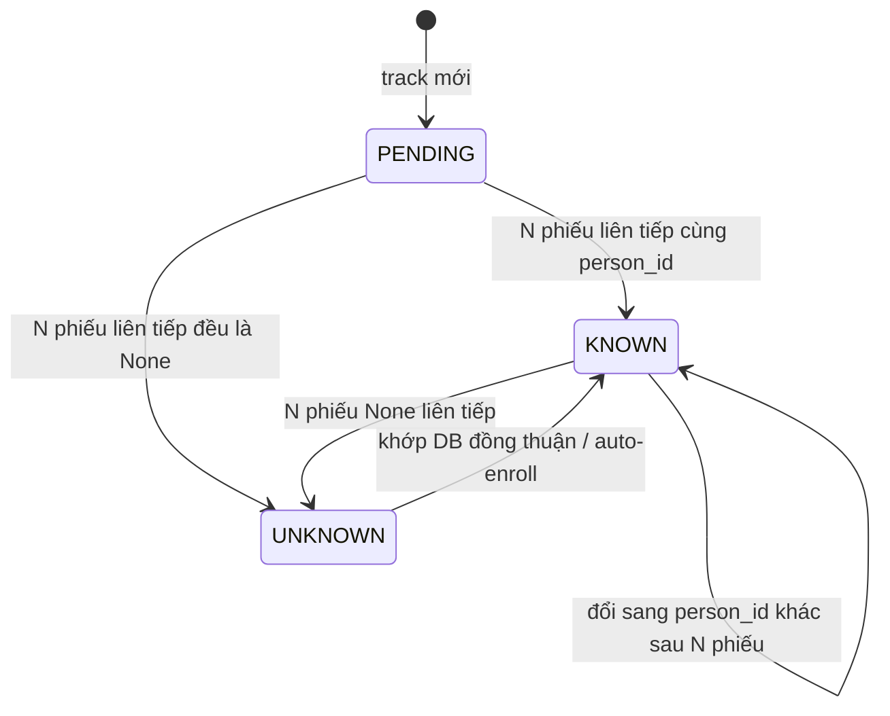
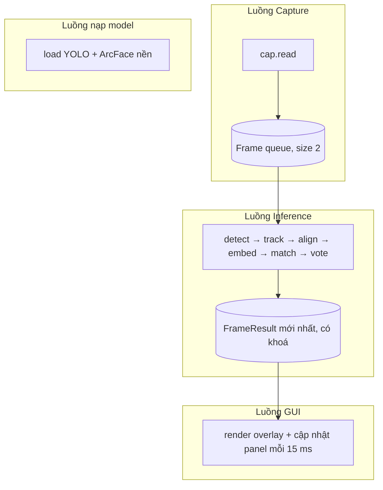

<h2 align="center">
  Author: Huynh Thanh Phong (ReoRioll)
</h2>

<p align="center">
   Computer Science of College of Information and Communication Technology of Can Tho University (Course 48)<br>
</p>

<p>
&nbsp;&nbsp;&nbsp;&nbsp;&nbsp;&nbsp;&nbsp;&nbsp;&nbsp;&nbsp;&nbsp;&nbsp;&nbsp;&nbsp;&nbsp;&nbsp;&nbsp;&nbsp;
<b>Researchs:</b> Artificial Intelligence in Education - Mathematics in Deep Learning and Machine Learning<br>

&nbsp;&nbsp;&nbsp;&nbsp;&nbsp;&nbsp;&nbsp;&nbsp;&nbsp;&nbsp;&nbsp;&nbsp;&nbsp;&nbsp;&nbsp;&nbsp;&nbsp;&nbsp;
<mark><b><b>Name Project:</b></b> </mark> Hệ thống nhận diện và tái định danh khuôn mặt nhiều người theo thời gian thực dựa trên YOLOv8-Face và ArcFace<br>

</p>
<p align="center">
   <b>Presional link Information</b>
</p>

<p>
&nbsp;&nbsp;&nbsp;&nbsp;&nbsp;&nbsp;&nbsp;&nbsp;&nbsp;&nbsp;&nbsp;&nbsp;&nbsp;&nbsp;&nbsp;&nbsp;&nbsp;&nbsp;
Facbook: https://www.facebook.com/huynh.thanh.phong.561667 <br>

&nbsp;&nbsp;&nbsp;&nbsp;&nbsp;&nbsp;&nbsp;&nbsp;&nbsp;&nbsp;&nbsp;&nbsp;&nbsp;&nbsp;&nbsp;&nbsp;&nbsp;&nbsp;
Kaggle: https://www.kaggle.com/reorioll <br>

&nbsp;&nbsp;&nbsp;&nbsp;&nbsp;&nbsp;&nbsp;&nbsp;&nbsp;&nbsp;&nbsp;&nbsp;&nbsp;&nbsp;&nbsp;&nbsp;&nbsp;&nbsp;
Youtobe: https://www.youtube.com/@ReoRioll-2304CICTCTU <br>
</p>
<br>

```python
!git clone https://github.com/huynhthanhphong231004IT/FaceID_Tracking.git
```

# Evaluation and analysis

<div align="center">
<p align="center">
  
  <br>
  <i> Trực quan hóa tiến trình theo dõi và lọc tư thế khuôn mặt theo các mốc thời gian ($t = 0,0\text{ s}$ đến $11,5\text{ s}$). Hệ thống xác nhận khuôn mặt ở các góc nhìn chính diện ($t = 0,0\text{ s}, 2,3\text{ s}, 11,5\text{ s}$) và tự động loại bỏ các góc quay vượt ngưỡng cho phép ($t = 4,6\text{ s}, 6,9\text{ s}, 9,2\text{ s}$).</i>
  
  <i> Video nguồn: https://youtube.com/shorts/N9K7xtOaClA?si=WpuRVpDDOEWw7Cmp</i>
</p>
</div>

<div align="center">
<p align="center">
  
  <br>
  <i>Biểu đồ phân tích đặc trưng theo thời gian của video VD_01.mp4 (346 khung hình, 29,97 FPS, 720 x 1280). Từ trên xuống dưới: độ sáng trung bình, độ sắc nét (phương sai Laplacian), và mức độ chuyển động giữa các khung hình kề nhau.</i>
</p>
</div>


Đoạn video `VD_01.mp4` là dữ liệu kiểm thử lý tưởng nhờ chứa đựng các thử thách kỹ thuật đa dạng, ép hệ thống phải hoạt động trong cả điều kiện thường lẫn các tình huống biên (edge cases). Sự đan xen giữa các khoảng tín hiệu êm đềm và các pha biến động đột ngột (như độ sáng tăng vọt ở cuối hay chuyển động chập nhấp liên tục) giúp đánh giá chính xác khả năng thích ứng và độ bền của thuật toán trước hiện tượng nhiễu hay thay đổi ngữ cảnh. Bên cạnh đó, các thông số chuẩn HD cùng 29,97 FPS tạo ra một bài test tiệm cận kịch bản thực tế nhưng vẫn tối ưu được chi phí tính toán khi chạy thử nghiệm nhiều lần. Qua đó, kết quả thu được phản ánh chân thực hiệu năng thực tế của hệ thống thay vì chỉ kiểm thử trong điều kiện phòng thí nghiệm hoàn hảo.

<div align="center">
<p align="center">
  
  <br>
  <i>Đánh giá hiệu năng hệ thống qua chất lượng theo dõi, bộ lọc tư thế đầu và độ trễ tính toán. (a) Biến thiên theo thời gian của các chỉ số hiệu năng đã chuẩn hóa. (b) Ước lượng tư thế đầu (Yaw, Pitch, Roll) cùng các khoảng khung hình bị loại bỏ. (c) Phân bố khung hình chấp nhận (n=209) và loại bỏ (n=135) trên không gian Yaw-Pitch. (d) Thống kê nguyên nhân loại bỏ khuôn mặt. (e) Phân bố khoảng cách Cosine của các đặc trưng khuôn mặt cùng ngưỡng khớp/cập nhật. (f) Độ tin cậy khớp so với góc Yaw tuyệt đối. (g) Thời gian xử lý trung bình từng mô-đun. (h) Biến thiên độ trễ theo thời gian so với giới hạn thời gian thực.</i>
</p>
</div>

Đánh giá tổng thể cho thấy bộ lọc chất lượng (quality-gate) vận hành hiệu quả khi loại bỏ chính xác 135 khung hình vượt ngưỡng nghiêng mặt ($\vert{}\text{Yaw}\vert{} > 20^\circ$ hoặc $\vert{}\text{Pitch}\vert{} > 20^\circ$) [Hình b, c, d], giúp đảm bảo khoảng cách Cosine của các đặc trưng khuôn mặt tập trung ở vùng an toàn ($<0.1$) và duy trì độ tin cậy khớp cao [Hình e, f]. Tuy nhiên, hệ thống đối mặt với nghẽn cổ chai lớn về mặt thời gian thực: mô-đun YOLO ($178\text{ ms}$) và ArcFace ($116\text{ ms}$) chiếm phần lớn chi phí tính toán [Hình g], khiến tổng độ trễ dao động từ $10^2$ đến $10^3\text{ ms}$—vượt xa giới hạn thời gian thực (real-time budget) [Hình h] và đẩy tỉ lệ FPS thực tế xuống mức rất thấp ($\approx 0.1 \text{--} 0.4$) [Hình a]. Điều này khẳng định bộ lọc góc mặt giúp tối ưu độ chính xác nhận diện nhưng hệ thống cần được tối ưu hóa phần cứng (như TensorRT/GPU acceleration) hoặc tinh gọn mô hình để đáp ứng yêu cầu xử lý thời gian thực.

# Face Tracker — Real-time Multi-person Face Re-Identification (YOLOv8-Face + ArcFace)

> Tài liệu cơ sở lý thuyết của hệ thống nhận diện và tái định danh (Re-ID) khuôn mặt nhiều người theo thời gian thực. Nội dung trình bày theo cấu trúc của một bài báo khoa học: bài toán, kiến trúc, từng module với công thức, siêu tham số, phương pháp đánh giá và tài liệu tham khảo.

---

## Mục lục

1. [Tóm tắt](#1-tóm-tắt)
2. [Phát biểu bài toán](#2-phát-biểu-bài-toán)
3. [Kiến trúc tổng thể](#3-kiến-trúc-tổng-thể)
4. [Phát hiện khuôn mặt bằng YOLOv8-Face](#4-phát-hiện-khuôn-mặt-bằng-yolov8-face)
5. [Căn chỉnh khuôn mặt (Face Alignment)](#5-căn-chỉnh-khuôn-mặt-face-alignment)
6. [Đánh giá chất lượng: tư thế đầu và độ nét](#6-đánh-giá-chất-lượng-tư-thế-đầu-và-độ-nét)
7. [Trích xuất đặc trưng ArcFace](#7-trích-xuất-đặc-trưng-arcface)
8. [So khớp danh tính (Identity Matching)](#8-so-khớp-danh-tính-identity-matching)
9. [Theo vết đa đối tượng và bỏ phiếu thời gian](#9-theo-vết-đa-đối-tượng-và-bỏ-phiếu-thời-gian)
10. [Cập nhật mẫu đặc trưng trực tuyến](#10-cập-nhật-mẫu-đặc-trưng-trực-tuyến)
11. [Tự động đăng ký người lạ (Auto-Enrollment)](#11-tự-động-đăng-ký-người-lạ-auto-enrollment)
12. [Cơ sở dữ liệu đặc trưng](#12-cơ-sở-dữ-liệu-đặc-trưng)
13. [Kiến trúc đa luồng và độ phức tạp](#13-kiến-trúc-đa-luồng-và-độ-phức-tạp)
14. [Bảng siêu tham số](#14-bảng-siêu-tham-số)
15. [Phương pháp đánh giá](#15-phương-pháp-đánh-giá)
16. [Cấu trúc thư mục](#16-cấu-trúc-thư-mục)
17. [Cài đặt và chạy](#17-cài-đặt-và-chạy)
18. [Tài liệu tham khảo](#18-tài-liệu-tham-khảo)

---

## 1. Tóm tắt

<div align="center">
<p align="center">
  
  <br>
  <i>Sơ đồ kiến trúc hệ thống nhận diện, theo dõi và tự động cập nhật dữ liệu khuôn mặt. Quy trình gồm 10 bước chính từ tiếp nhận luồng video (Video Stream), phát hiện khuôn mặt (Detection), căn chỉnh (Alignment), lọc chất lượng (Quality Filter), trích xuất đặc trưng (Embedding), đối khớp (Matching), theo dõi (Tracking), bỏ phiếu đa khung hình (Voting), học liên tục (Continuous Learning) đến lưu trữ (Storage).</i>
</p>
</div>


Hệ thống thực hiện <mark> (1) phát hiện → (2) căn chỉnh → (3) lọc chất lượng → (4) trích xuất embedding → (5) so khớp → (6) theo vết → (7) xác nhận danh tính</mark> trên luồng video (webcam hoặc file). Các đặc điểm chính:

\- Phát hiện: YOLOv8n-face (one-stage, anchor-free) cho hộp bao và 5 điểm landmark; có cơ chế dự phòng (fallback) bằng bộ phát hiện của InsightFace khi thiếu landmark.

\- Biểu diễn: ArcFace (`buffalo_l`, ResNet-50 backbone, embedding 512 chiều, chuẩn hoá L2).

\- Lọc chất lượng: ước lượng góc đầu (yaw/pitch/roll) bằng bài toán PnP từ 5 landmark và độ nét bằng phương sai Laplacian; chỉ khung hình đạt chuẩn mới được dùng để nhận diện.

\- Ổn định danh tính: bỏ phiếu đồng thuận trên $N$ khung hình liên tiếp trên từng track.

\- Học liên tục: cập nhật vector trung bình theo thời gian và tự đăng ký người lạ khi bằng chứng đủ nhất quán.

\- Lưu trữ: mỗi người được biểu diễn bằng một vector trung bình (centroid) lưu trong CSV.

---

## 2. Phát biểu bài toán

<p>
  Cho chuỗi khung hình . Tại mỗi khung hình, hệ thống cần xác định tập các khuôn mặt , và gán cho mỗi khuôn mặt một danh tính  với  là tập danh tính đã đăng ký (gallery). Đây là bài toán open-set identification: mặt có thể không thuộc gallery và phải bị từ chối.
</p>

<p>
  Gọi  là bộ trích xuất đặc trưng ánh xạ ảnh mặt đã căn chỉnh lên siêu cầu đơn vị. Danh tính được quyết định theo:
</p>

<p align="center">
  
</p>

<p>
  với  là vector trung bình của danh tính ,  là khoảng cách cosine, và  là ngưỡng so khớp (<code>MATCH_DISTANCE_THRESHOLD = 0.45</code>).
</p>

---

## 3. Kiến trúc tổng thể



Luồng dữ liệu theo từng khung hình (tương ứng `RecognitionPipeline._process_frame`):



---

## 4. Phát hiện khuôn mặt bằng YOLOv8-Face

### 4.1 Mô hình

YOLOv8 [[1]](#18-tài-liệu-tham-khảo) là bộ phát hiện một giai đoạn, anchor-free với đầu dự đoán tách rời (decoupled head) cho phân loại và hồi quy hộp. Biến thể face bổ sung nhánh keypoints dự đoán 5 điểm landmark (hai mắt, mũi, hai khoé miệng), theo ý tưởng của YOLOv5-Face [[2]](#18-tài-liệu-tham-khảo) và pose head của YOLOv8-Pose.

Hộp bao được hồi quy dưới dạng phân phối rời rạc trên $r+1$ bin (Distribution Focal Loss) [[3]](#18-tài-liệu-tham-khảo):

$$
\hat{l}=\sum_{i=0}^{r} i\cdot \mathrm{softmax}(\mathbf{z})_i,\qquad
\mathcal{L}_{\mathrm{DFL}}=-\big((y_{i+1}-y)\log S_i+(y-y_i)\log S_{i+1}\big)
$$

### 4.2 Hàm mất mát khi huấn luyện

$$
\mathcal{L}=\lambda_{\mathrm{box}}\mathcal{L}_{\mathrm{CIoU}}+\lambda_{\mathrm{dfl}}\mathcal{L}_{\mathrm{DFL}}+\lambda_{\mathrm{cls}}\mathcal{L}_{\mathrm{BCE}}+\lambda_{\mathrm{kpt}}\mathcal{L}_{\mathrm{kpt}}
$$

Trong đó CIoU [[4]](#18-tài-liệu-tham-khảo):

$$
\mathcal{L}_{\mathrm{CIoU}}=1-\mathrm{IoU}+\frac{\rho^2(\mathbf{b},\mathbf{b}^{gt})}{c^2}+\alpha v,\quad
v=\frac{4}{\pi^2}\Big(\arctan\frac{w^{gt}}{h^{gt}}-\arctan\frac{w}{h}\Big)^2,\quad
\alpha=\frac{v}{(1-\mathrm{IoU})+v}
$$

và mất mát keypoint dựa trên Object Keypoint Similarity (OKS):

$$
\mathcal{L}_{\mathrm{kpt}}=1-\frac{\sum_k \exp\!\big(-d_k^2/(2s^2\kappa_k^2)\big)\,\delta(v_k>0)}{\sum_k\delta(v_k>0)}
$$

với $d_k$ là sai số Euclid của landmark thứ $k$, $s$ là diện tích đối tượng, $\kappa_k$ là hằng số theo từng điểm.

### 4.3 Hậu xử lý: NMS

Các hộp trùng lặp bị loại bằng Non-Maximum Suppression với ngưỡng IoU `YOLO_IOU = 0.5`; ngưỡng điểm tin cậy `YOLO_CONF = 0.5`, tối đa `YOLO_MAX_DET = 20` khuôn mặt, kích thước đầu vào `YOLO_IMGSZ = 640`.

$$
\mathrm{IoU}(A,B)=\frac{|A\cap B|}{|A\cup B|}
$$

### 4.4 Cơ chế dự phòng landmark

Nếu đầu ra keypoint của YOLO bằng 0 (không có landmark), hệ thống cắt vùng mặt có lề $m=0.40$ và chạy bộ phát hiện SCRFD của InsightFace [[15]](#18-tài-liệu-tham-khảo) (`LANDMARK_FALLBACK_SIZE = (192,192)`, `LANDMARK_DET_THRESH = 0.30`) để lấy 5 điểm, sau đó tịnh tiến về hệ toạ độ khung hình gốc:

$$
\mathbf{k}_j^{\text{frame}}=\mathbf{k}_j^{\text{crop}}+(c_{x1},c_{y1})^\top,\qquad j=1,\dots,5
$$

---

## 5. Căn chỉnh khuôn mặt (Face Alignment)

<p>
  ArcFace được huấn luyện trên ảnh mặt chuẩn hoá . Với 5 landmark phát hiện được  và 5 điểm mẫu chuẩn , ta tìm phép biến đổi đồng dạng (<em>similarity transform</em>: tỉ lệ, quay, tịnh tiến) tối ưu theo bình phương tối thiểu:
</p>

<p align="center">
  
</p>

<p>
  Nghiệm đóng được cho bởi phương pháp Umeyama thông qua SVD của ma trận hiệp phương sai chéo:
</p>

<p align="center">
  
</p>

<p>
  Ảnh được warp bằng phép biến đổi affine tương ứng thành ảnh  (<code>insightface.utils.face_align.norm_crop</code>, <code>ALIGN_SIZE = 112</code>).
</p>

---

## 6. Đánh giá chất lượng: tư thế đầu và độ nét

<p>
  Embedding từ mặt nghiêng, mờ hoặc quá nhỏ kém tin cậy và làm nhiễu cơ sở dữ liệu. Hệ thống áp dụng <strong>cổng chất lượng</strong> (<em>quality gate</em>) trước khi trích xuất đặc trưng. Một khung mặt là <code>is_good</code> khi <strong>đồng thời</strong> thoả cả ba điều kiện:
</p>

<p align="center">
  
</p>

<h3>6.1 Ước lượng tư thế đầu bằng PnP</h3>

<p>
  Dùng mô hình mặt 3D thô gồm 5 điểm  (mắt trái, mắt phải, mũi, khoé miệng trái, khoé miệng phải) và 5 landmark 2D , ta giải bài toán <strong>Perspective-n-Point</strong> bằng cực tiểu hoá sai số tái chiếu:
</p>

<p align="center">
  
</p>

<p>
  với ma trận nội tham số xấp xỉ ,  (bề rộng ảnh),  là trọng tâm các landmark, không có méo ảnh. Khởi tạo bằng EPnP, tinh chỉnh bằng Levenberg–Marquardt (<code>SOLVEPNP_ITERATIVE</code>). Nghiệm hợp lệ yêu cầu 0" title="tz > 0" /> (mặt nằm trước camera).
</p>

<p>
  Từ vector quay Rodrigues , các góc Euler được tính (chỉ số bắt đầu từ 1):
</p>

<p align="center">
  
</p>

<h3>6.2 Độ nét bằng phương sai Laplacian</h3>

<p>
  Độ nét của ảnh mặt đã căn chỉnh (chuyển xám ) được đo bằng phương sai của toán tử Laplace:
</p>

<p align="center">
  
</p>

<p>
  Ảnh mờ có ít cạnh sắc nên  nhỏ. Ảnh bị loại nếu  (<code>BLUR_THRESHOLD = 35</code>).
</p>

---

## 7. Trích xuất đặc trưng ArcFace

<h3>7.1 Mô hình</h3>

<p>
  Bộ nhận dạng là ArcFace trong gói <code>buffalo_l</code> của InsightFace (backbone dạng ResNet), cho đầu ra .
</p>

<h3>7.2 Hàm mất mát Additive Angular Margin</h3>

<p>
  Với embedding  thuộc lớp  và trọng số lớp , sau khi chuẩn hoá  thì logit là . ArcFace thêm lề góc  vào lớp đúng và nhân tỉ lệ :
</p>

<p align="center">
  
</p>

<p>
  Lề góc  ép các lớp tách xa nhau hơn trên siêu cầu, tăng tính phân biệt: <strong>nội lớp gọn, liên lớp xa</strong>. Đây là lý do khoảng cách cosine giữa hai embedding là thước đo hợp lý ở giai đoạn suy luận.
</p>

<h3>7.3 Chuẩn hoá L2 khi suy luận</h3>

<p align="center">
  
</p>

<p>
  Nhờ đó tích vô hướng bằng độ tương đồng cosine và mọi phép so khớp quy về nhân ma trận. Các mặt đạt chuẩn trong một khung hình được suy luận theo <strong>batch</strong> để tận dụng song song.
</p>

---

<h2>8. So khớp danh tính (Identity Matching)</h2>

<h3>8.1 Khoảng cách và ma trận khoảng cách</h3>

<p>
  Với  embedding truy vấn  và gallery  (mỗi hàng là vector trung bình đã chuẩn hoá):
</p>

<p align="center">
  
</p>

<h3>8.2 Gán một-một tham lam (Greedy One-to-One Assignment)</h3>

<p>
  Để tránh hai mặt trong cùng khung hình cùng nhận một danh tính, tập các cặp hợp lệ  được sắp xếp tăng dần theo khoảng cách và gán lần lượt, bỏ qua cặp có hàng hoặc cột đã dùng:
</p>

<p align="center">
  
</p>

<p>
  Đây là xấp xỉ tham lam của bài toán gán tối ưu (thuật toán Hungarian), đủ chính xác khi số khuôn mặt nhỏ và các khoảng cách phân tách rõ, với độ phức tạp .
</p>

<h3>8.3 Độ tin cậy</h3>

<p>
  Độ tin cậy hiển thị cho một khớp là độ tương đồng cosine . Với , ngưỡng tương đương 0.55" title="cos theta > 0.55" />. Giá trị  (khoảng cách tới người gần nhất, kể cả khi vượt ngưỡng) được giữ lại để phục vụ cơ chế tự đăng ký (mục 11).
</p>

---

## 9. Theo vết đa đối tượng và bỏ phiếu thời gian

### 9.1 Theo vết dựa trên IoU

Mỗi hộp phát hiện được gán cho một track dựa trên ma trận IoU giữa hộp hiện tại và hộp cuối của track, theo kiểu tham lam giống SORT [[11]](#18-tài-liệu-tham-khảo) nhưng không dùng bộ lọc Kalman:

$$
\mathrm{IoU}_{dt}\ge\tau_{\mathrm{iou}}=0.30\ \Rightarrow\ \text{ứng viên ghép};\qquad
\text{track bị xoá nếu } \text{missed}>20 \text{ khung hình}
$$

Detection không ghép được sẽ tạo track mới (`track_id` tăng dần). Cách đơn giản này phù hợp với camera tĩnh và mặt di chuyển chậm; nhược điểm là dễ đổi ID khi các mặt giao nhau nhanh (xem mục 15.5).

### 9.2 Máy trạng thái của track



### 9.3 Quy tắc bỏ phiếu đồng thuận

Mỗi track giữ hàng đợi $V=(v_{t-N+1},\dots,v_t)$ gồm $N=5$ phiếu gần nhất, $v_t\in\mathcal{G}\cup\{\varnothing\}$ (chỉ thêm phiếu khi khung mặt `is_good`). Trạng thái chỉ đổi khi đồng thuận tuyệt đối:

$$
\text{state}=
\begin{cases}
\text{KNOWN}(g) & \text{nếu } |V|=N,\ v_i=g\ \forall i,\ g\in\mathcal{G}\\
\text{UNKNOWN} & \text{nếu } |V|=N,\ v_i=\varnothing\ \forall i\\
\text{giữ nguyên} & \text{ngược lại}
\end{cases}
$$

Độ tin cậy của track được làm mượt bằng trung bình trượt mũ (EMA):

$$
\bar s_t=0.7\,\bar s_{t-1}+0.3\,s_t
$$

**Lợi ích**: nếu xác suất một khung bị nhận sai là $p$ thì xác suất cả $N$ khung cùng sai theo *cùng một* danh tính chỉ cỡ $\le p^N$ (xét xấp xỉ độc lập), giảm mạnh nhận nhầm và hiện tượng nhấp nháy nhãn, đổi lại độ trễ xác nhận khoảng $N$ khung hình hợp lệ.

---

<h2>10. Cập nhật mẫu đặc trưng trực tuyến</h2>

<p>
  Khi track đã <code>KNOWN</code> và khung hiện tại khớp <strong>rất chắc</strong> (), embedding mới được hợp nhất vào danh tính để thích nghi với thay đổi ngoại hình (ánh sáng, biểu cảm, tuổi tác). Mỗi người lưu tổng vector  và số mẫu ; vector đại diện là:
</p>

<p align="center">
  
</p>

<p>
  Cập nhật có <strong>cửa sổ trượt xấp xỉ</strong> với  <code>MAX_FEATURES_PER_PERSON = 100</code>:
</p>

<p align="center">
  
</p>

<p>
  Khi = K" /> đây là <strong>trung bình trượt mũ</strong> với hệ số quên , nên bộ nhớ  cho mỗi người, đồng thời giảm ảnh hưởng của mẫu cũ. Hai cơ chế bảo vệ chống "trôi danh tính" (<em>identity drift</em>):
</p>

<ol>
  <li>Chỉ cập nhật khi  (ngưỡng cập nhật chặt hơn ngưỡng nhận diện).</li>
  <li>Giới hạn tần suất tối thiểu <code>FEATURE_UPDATE_MIN_INTERVAL = 1.0</code> giây giữa hai lần cập nhật.</li>
</ol>

---

## 11. Tự động đăng ký người lạ (Auto-Enrollment)

Khi một track ở trạng thái `UNKNOWN`, hệ thống gom các embedding của người đó vào một **ứng viên** (*candidate*) và chỉ tạo ID mới khi bằng chứng đủ mạnh và nhất quán.

### 11.1 Điều kiện đưa mẫu vào hồ ứng viên

Mẫu từ khung `is_good`, track `UNKNOWN`, không có khớp trong DB, kích thước mặt $\ge 80$ px (`AUTO_ENROLL_MIN_FACE_SIZE`) và **cách xa mọi người trong DB**:

$$
d_{\text{nearest}}\ge\tau_{\mathrm{db}}=0.55>\tau_m
$$

Khoảng trống giữa $\tau_m=0.45$ và $\tau_{\mathrm{db}}=0.55$ là vùng đệm tránh tạo trùng ID cho một người đã có trong DB nhưng bị nhận sai tạm thời.

### 11.2 Gom cụm ứng viên

Một embedding $\hat{\mathbf{e}}$ được gán cho ứng viên gần nhất có tâm $\mathbf{c}_k=\mathbf{s}_k/\|\mathbf{s}_k\|$ nếu $1-\hat{\mathbf{e}}^\top\mathbf{c}_k<\tau_m$; nếu không, tạo ứng viên mới (tối đa 8, loại ứng viên cũ nhất). Một mẫu chỉ được cộng vào ứng viên khi cách mẫu trước $\ge 0.15$ giây để giảm tương quan giữa các mẫu liên tiếp.

### 11.3 Tiêu chí chấp nhận (coherence)

Với tập mẫu $\{\mathbf{x}_i\}_{i=1}^n$ và tâm $\mathbf{c}$, độ nhất quán là:

$$
\bar{\rho}=\frac{1}{n}\sum_i\mathbf{x}_i^\top\mathbf{c},\qquad
\rho_{\min}=\min_i\ \mathbf{x}_i^\top\mathbf{c}
$$

$$
\text{READY}\iff n\ge 20,\ \ \bar\rho\ge0.60,\ \ \rho_{\min}\ge0.40,\ \ t_{\text{last}}-t_{\text{first}}\ge 3.0\text{ s}
$$

$$
\text{REJECT}\iff \neg\text{coherent}\ \wedge\ n\ge 40
$$

Điều kiện thời gian $\ge3$ s đảm bảo mẫu trải trên một khoảng quan sát đủ dài (đa dạng tư thế/ánh sáng) và loại bỏ trường hợp ảnh lướt qua. Ứng viên `REJECT` (cụm không đồng nhất, có thể lẫn nhiều người) bị huỷ mà không tạo ID. Ứng viên hết hạn sau `TTL = 20` s không được quan sát.

Trước khi ghi, hệ thống kiểm tra lại lần cuối khoảng cách tâm tới DB ($<\tau_{\mathrm{db}}$ thì bỏ). Khi chấp nhận, danh tính mới được tạo với tên mặc định `Person_XXXXX` và vector khởi tạo là tổng các mẫu.

### 11.4 Đăng ký thủ công

Hàm `RecognitionPipeline.begin_enrollment` thu thập `ENROLL_SAMPLES = 12` mẫu đạt chuẩn (cách nhau $\ge0.2$ s, timeout 60 s), tính trung bình L2-chuẩn hoá và từ chối trùng nếu khoảng cách tới người đã có $<\tau_m$.

---

## 12. Cơ sở dữ liệu đặc trưng

Mỗi người được biểu diễn bằng một vector trung bình (template-per-identity) thay vì lưu toàn bộ mẫu:

| Cột CSV | Ý nghĩa |
|---|---|
| `ID` | Mã người (số nguyên tăng dần) |
| `Name` | Tên hiển thị / tên tự động `Person_XXXXX` |
| `Feature_Vector_JSON` | Vector trung bình 512 chiều (làm tròn 6 chữ số) |
| `Updated_At` | Thời điểm cập nhật cuối |
| `Num_Features` | Số mẫu đã đóng góp |

Đặc điểm triển khai:

\- Ma trận gallery $\mathbf{M}\in\mathbb{R}^{M\times512}$ được dựng sẵn trong bộ nhớ, nên truy vấn là một phép nhân ma trận $O(nMd)$.

\- Ghi nguyên tử: ghi vào file `.csv.tmp` rồi `os.replace` để không hỏng dữ liệu khi mất điện giữa chừng.

\- Tự động lưu định kỳ mỗi `DB_AUTOSAVE_INTERVAL = 10` s khi có thay đổi; thêm/đổi tên người lưu ngay lập tức.

\- An toàn luồng bằng `RLock` vì GUI, luồng suy luận và luồng đăng ký cùng truy cập.

\- Dòng CSV lỗi (sai chiều, NaN, chuẩn ≈ 0) bị bỏ qua có cảnh báo, không làm hỏng việc nạp.

> Lưu ý: dùng một centroid cho mỗi người đơn giản và nhanh, nhưng kém biểu diễn các phân phối đa đỉnh (ví dụ đeo kính / không đeo kính). Có thể mở rộng sang nhiều prototype hoặc $k$-NN (xem mục 15.5).

---

## 13. Kiến trúc đa luồng và độ phức tạp



\- Webcam: hàng đợi nhỏ, khi đầy thì bỏ khung cũ để luôn xử lý khung mới nhất (giảm độ trễ).

\- File video: đọc theo đúng FPS gốc và chặn khi hàng đợi đầy (không rớt khung).

\- GUI chỉ vẽ khi `seq` đổi, không chặn luồng suy luận.

Độ phức tạp mỗi khung hình với $n$ mặt, gallery $M$, chiều $d=512$:

$$
T_{\text{frame}}=T_{\text{det}}(W,H)+n\,T_{\text{align}}+T_{\text{ArcFace}}(n)+O(nMd)+O(n\cdot|\text{tracks}|)
$$

Trong đó thành phần chi phối là $T_{\text{det}}$ và $T_{\text{ArcFace}}$ (mạng nơ-ron); bước so khớp và theo vết là không đáng kể với $M\lesssim10^4$. Với $M$ rất lớn nên chuyển sang chỉ mục xấp xỉ (FAISS/HNSW).

---

## 14. Bảng siêu tham số

| Nhóm | Tham số | Giá trị | Vai trò |
|---|---|---|---|
| Phát hiện | `YOLO_CONF` | 0.5 | Ngưỡng điểm tin cậy |
| | `YOLO_IOU` | 0.5 | Ngưỡng NMS |
| | `YOLO_IMGSZ` | 640 | Kích thước vào mạng |
| | `YOLO_MAX_DET` | 20 | Số mặt tối đa/khung |
| Căn chỉnh | `ALIGN_SIZE` | 112 | Kích thước ảnh mặt chuẩn |
| Chất lượng | `MIN_FACE_SIZE` | 48 px | Cạnh nhỏ nhất của bbox |
| | `POSE_MAX_YAW/PITCH/ROLL` | 20° | Góc đầu tối đa |
| | `BLUR_THRESHOLD` | 35 | Ngưỡng phương sai Laplacian |
| So khớp | `MATCH_DISTANCE_THRESHOLD` $\tau_m$ | 0.45 | Ngưỡng nhận diện (cosine dist.) |
| | `UPDATE_DISTANCE_THRESHOLD` $\tau_u$ | 0.30 | Ngưỡng cập nhật template |
| | `N_CONFIRM_FRAMES` $N$ | 5 | Số phiếu đồng thuận |
| | `MAX_FEATURES_PER_PERSON` $K$ | 100 | Cửa sổ trượt cho centroid |
| | `FEATURE_UPDATE_MIN_INTERVAL` | 1.0 s | Giãn cách cập nhật |
| Theo vết | `TRACK_IOU_THRESHOLD` | 0.30 | Ngưỡng ghép IoU |
| | `TRACK_MAX_MISSED` | 20 | Số khung mất dấu tối đa |
| Auto-enroll | `AUTO_ENROLL_MIN_SAMPLES` | 20 | Số mẫu tối thiểu |
| | `AUTO_ENROLL_MIN_SECONDS` | 3.0 s | Thời gian quan sát tối thiểu |
| | `AUTO_ENROLL_SAMPLE_INTERVAL` | 0.15 s | Giãn cách lấy mẫu |
| | `AUTO_ENROLL_COHERENCE_MEAN/MIN` | 0.60 / 0.40 | Ngưỡng nhất quán |
| | `AUTO_ENROLL_MIN_DB_DISTANCE` $\tau_{db}$ | 0.55 | Khoảng cách tối thiểu tới DB |
| | `AUTO_ENROLL_MIN_FACE_SIZE` | 80 px | Cỡ mặt tối thiểu |
| | `AUTO_ENROLL_CANDIDATE_TTL` | 20 s | Thời gian sống ứng viên |
| Thủ công | `ENROLL_SAMPLES` | 12 | Số mẫu đăng ký |

Quan hệ ràng buộc giữa các ngưỡng (cần giữ để hệ thống hoạt động đúng):

$$
\tau_u<\tau_m<\tau_{\mathrm{db}}\qquad(0.30<0.45<0.55)
$$

Ý nghĩa: chỉ cập nhật khi rất chắc ($\tau_u$), nhận diện khi đủ giống ($\tau_m$), và chỉ tạo người mới khi chắc chắn *không giống ai* trong DB ($\tau_{\mathrm{db}}$).

---

## 15. Phương pháp đánh giá

### 15.1 Chỉ số xác minh (verification)

Với các cặp (cùng người / khác người), đặt ngưỡng $\tau$ trên khoảng cách cosine:

$$
\mathrm{TAR}(\tau)=\frac{|\{\text{cặp cùng người}: d<\tau\}|}{|\text{cặp cùng người}|},\qquad
\mathrm{FAR}(\tau)=\frac{|\{\text{cặp khác người}: d<\tau\}|}{|\text{cặp khác người}|}
$$

$$
\mathrm{EER}:\ \mathrm{FAR}(\tau^\ast)=\mathrm{FRR}(\tau^\ast)=1-\mathrm{TAR}(\tau^\ast)
$$

Báo cáo đường cong ROC, `TAR@FAR=1e-3`, `TAR@FAR=1e-4` và EER; $\tau_m$ nên chọn từ điểm vận hành mong muốn trên ROC của dữ liệu triển khai thực tế.

### 15.2 Chỉ số định danh open-set

$$
\mathrm{DIR}(\tau,k)=\frac{|\{\text{mặt trong gallery được xếp hạng đúng ở top-}k\ \wedge\ d<\tau\}|}{|\text{mặt có trong gallery}|},\qquad
\mathrm{FPIR}(\tau)=\frac{|\{\text{mặt ngoài gallery bị nhận nhầm}: d<\tau\}|}{|\text{mặt ngoài gallery}|}
$$

### 15.3 Chỉ số theo vết và Re-ID theo thời gian

\- IDF1 [[12]](#18-tài-liệu-tham-khảo): $\mathrm{IDF1}=\dfrac{2\,\mathrm{IDTP}}{2\,\mathrm{IDTP}+\mathrm{IDFP}+\mathrm{IDFN}}$ đo mức giữ đúng danh tính qua thời gian.

\- MOTA [[13]](#18-tài-liệu-tham-khảo): $\mathrm{MOTA}=1-\dfrac{\mathrm{FN}+\mathrm{FP}+\mathrm{IDSW}}{\mathrm{GT}}$.

\- ID switches / phút, thời gian xác nhận trung bình (số khung tới khi `KNOWN`), tỉ lệ trùng ID (một người bị tạo nhiều ID) và tỉ lệ gộp ID (nhiều người chung một ID) để đánh giá auto-enroll.

### 15.4 Chỉ số hiệu năng

FPS đầu-cuối, độ trễ mỗi khung (ms), mức dùng GPU/CPU/RAM theo số mặt $n$ trong khung.

### 15.5 Hạn chế đã biết

\- Tracker IoU thuần không có chuyển động dự đoán nên dễ đổi ID khi giao nhau, có thể thay bằng ByteTrack/DeepSORT [[14]](#18-tài-liệu-tham-khảo) hoặc thêm embedding làm *appearance cue*.

\- Một centroid mỗi người không mô tả được phân phối đa đỉnh.

\- Mô hình tư thế dùng 5 điểm với nội tham số camera xấp xỉ ($f=W$) nên sai số góc chỉ phù hợp để **lọc thô**, không phải đo lường chính xác.

\- Chất lượng embedding giảm với mặt bị che (khẩu trang), ánh sáng cực đoan và độ phân giải thấp.

\- Dữ liệu sinh trắc học là thông tin nhạy cảm: cần tuân thủ quy định bảo vệ dữ liệu cá nhân và có sự đồng ý của người được nhận diện khi triển khai thực tế.

---

## 16. Cấu trúc thư mục

```
face_tracker_app/
├── main.py                     # Điểm khởi chạy, kiểm tra phụ thuộc, tham số --cpu/--debug
├── config.py                   # Toàn bộ siêu tham số và đường dẫn
├── pipeline.py                 # RecognitionPipeline: điều phối luồng suy luận
├── requirements.txt
├── database/
│   └── face_features.csv       # CSDL vector trung bình
├── models/
│   ├── yolo_detector.py        # YoloFaceDetector (+ landmark fallback)
│   ├── arcface_extractor.py    # ArcFaceExtractor (align + embed)
│   └── weights/                # yolov8n-face.pt, insightface/buffalo_l
├── utils/
│   ├── feature_manager.py      # FeatureManager: CSV, centroid, cập nhật
│   ├── candidate_pool.py       # CandidatePool: auto-enroll
│   ├── pose_estimator.py       # PoseEstimator: PnP + Laplacian
│   ├── tracker.py              # FaceTracker: IoU + bỏ phiếu
│   └── video_source.py         # VideoSource: webcam / file
└── gui/
    ├── app_ui.py               # Giao diện CustomTkinter
    └── overlay.py              # Vẽ bbox, nhãn, góc đầu lên khung hình
```

---

## 17. Cài đặt và chạy

```bash
# 1. Tạo môi trường (khuyến nghị Python 3.9 – 3.11)
python -m venv .venv
source .venv/bin/activate          # Windows: .venv\Scripts\activate

# 2. Cài thư viện
pip install -r requirements.txt

# 3. Chạy
python main.py                     # tự dùng GPU nếu có
python main.py --cpu               # ép chạy CPU
python main.py --debug             # log chi tiết
```

Lần chạy đầu cần Internet để tải trọng số `yolov8n-face.pt` và gói `buffalo_l` của InsightFace (lưu trong `models/weights/`). Với GPU NVIDIA, cài `onnxruntime-gpu` thay cho `onnxruntime` và PyTorch bản CUDA để tăng tốc.

---

## 18. Tài liệu tham khảo

1. G. Jocher, A. Chaurasia, J. Qiu, *Ultralytics YOLOv8*, 2023. https://github.com/ultralytics/ultralytics
2. D. Qi, W. Tan, Q. Yao, J. Liu, "YOLO5Face: Why Reinventing a Face Detector," *ECCV Workshops*, 2022.
3. X. Li et al., "Generalized Focal Loss: Learning Qualified and Distributed Bounding Boxes for Dense Object Detection," *NeurIPS*, 2020.
4. Z. Zheng et al., "Distance-IoU Loss: Faster and Better Learning for Bounding Box Regression," *AAAI*, 2020 (CIoU).
5. S. Umeyama, "Least-Squares Estimation of Transformation Parameters Between Two Point Patterns," *IEEE TPAMI*, vol. 13, no. 4, 1991.
6. V. Lepetit, F. Moreno-Noguer, P. Fua, "EPnP: An Accurate O(n) Solution to the PnP Problem," *IJCV*, vol. 81, 2009.
7. J. L. Pech-Pacheco et al., "Diatom autofocusing in brightfield microscopy: a comparative study," *ICPR*, 2000 (phương sai Laplacian).
8. J. Deng, J. Guo, J. Yang, N. Xue, I. Kotsia, S. Zafeiriou, "ArcFace: Additive Angular Margin Loss for Deep Face Recognition," *IEEE CVPR*, 2019; bản mở rộng *IEEE TPAMI*, vol. 44, no. 10, 2022.
9. K. He, X. Zhang, S. Ren, J. Sun, "Deep Residual Learning for Image Recognition," *IEEE CVPR*, 2016.
10. H. W. Kuhn, "The Hungarian method for the assignment problem," *Naval Research Logistics Quarterly*, vol. 2, 1955.
11. A. Bewley, Z. Ge, L. Ott, F. Ramos, B. Upcroft, "Simple Online and Realtime Tracking," *IEEE ICIP*, 2016.
12. E. Ristani, F. Solera, R. Zou, R. Cucchiara, C. Tomasi, "Performance Measures and a Data Set for Multi-Target, Multi-Camera Tracking," *ECCV Workshops*, 2016 (IDF1).
13. K. Bernardin, R. Stiefelhagen, "Evaluating Multiple Object Tracking Performance: The CLEAR MOT Metrics," *EURASIP JIVP*, 2008.
14. N. Wojke, A. Bewley, D. Paulus, "Simple Online and Realtime Tracking with a Deep Association Metric," *IEEE ICIP*, 2017 (DeepSORT); Y. Zhang et al., "ByteTrack: Multi-Object Tracking by Associating Every Detection Box," *ECCV*, 2022.
15. J. Guo, J. Deng, A. Lattas, S. Zafeiriou, "Sample and Computation Redistribution for Efficient Face Detection," *ICLR*, 2022 (SCRFD, dùng làm landmark fallback).
16. InsightFace: 2D and 3D Face Analysis Project. https://github.com/deepinsight/insightface
